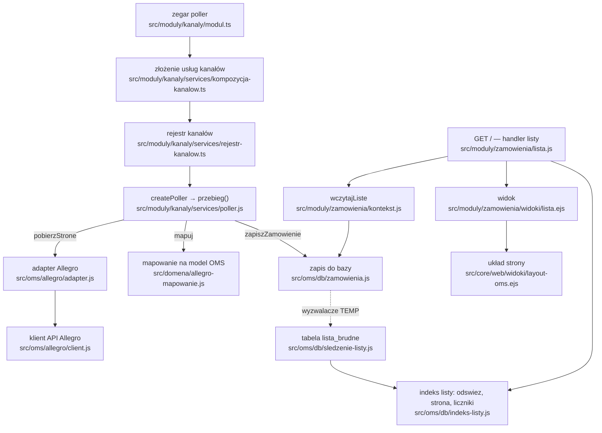

# Architektura — mapa kodu

Dla programisty, który widzi repo pierwszy raz. Mówi, **który plik** robi daną rzecz, i prowadzi jedno
zamówienie od pobrania z kanału sprzedaży do wiersza na liście zamówień. Ścieżki są pełne, od korzenia repo.
Numerów linii celowo nie ma — kod się przesuwa; szukaj po nazwie funkcji (`rg nazwaFunkcji src`).

## 1. Start procesu

- `src/oms.js` — punkt wejścia (trzy linie): woła `main()`.
- `src/main.ts` — `uruchomOms()`: bierze listę modułów (`modulyDla` z `src/moduly/lista.ts`), sprawdza konfigurację
  wszystkich modułów, zanim otworzy bazę (`sprawdzKonfiguracjeModulow` z `src/core/aplikacja.ts`), otwiera bazę
  (`otworzBazeStartu` z `src/oms/db/db.ts`) i oddaje wszystko do `uruchomAplikacje` z `src/core/uruchomienie.ts`.
- `src/core/uruchomienie.ts` — właściciel serwera HTTP, bazy i zegarów: buduje aplikację, nasłuchuje na porcie,
  uruchamia zegary modułów (`src/core/zegary.ts`) i sprząta przy zamknięciu.
- `src/core/aplikacja.ts` — `zbudujAplikacje()`: serce składania modułów (rozdział 3).

## 2. Warstwy `src/`

| katalog | co tam mieszka |
|---|---|
| `src/core` | rdzeń bez wiedzy o firmie: kontrakt modułu (`src/core/kontrakty.ts`), składanie (`src/core/aplikacja.ts`, `src/core/sprawdz-moduly.ts`), migracje (`src/core/baza.ts`), uprawnienia (`src/core/uprawnienia.ts`), tryb pracy (`src/core/tryb.ts`), bezpieczeństwo (`src/core/bezpieczenstwo/`), poczta (`src/core/poczta/`), warstwa WWW (`src/core/web/`) |
| `src/domena` | czyste reguły biznesowe bez HTTP i bez dostępu do bazy z zewnątrz: status zamówienia (`src/domena/status.js`), filtry listy (`src/domena/filtry-listy.js`), mapowanie Allegro (`src/domena/allegro-mapowanie.js`) itd. |
| `src/moduly` | moduły funkcji (zamówienia, kanały, faktury, wysyłka, magazyn…): trasy HTTP, widoki EJS, usługi, migracje; skład w `src/moduly/lista.ts` |
| `src/oms` | dostęp do bazy (`src/oms/db/`) i klienci zewnętrznych usług (`src/oms/allegro/`, `src/oms/woo/`, `src/oms/erli/`, `src/oms/kurierzy/`, `src/oms/ksef/`, `src/oms/infakt/`, `src/oms/gus/`…) |
| `src/integracje` | szew między modułami a klientami z `src/oms`: fabryki sprawdzane kontraktem (`src/integracje/fabryki.ts`), klucze integracji (`src/integracje/klucze.js`), opcje adapterów (`src/integracje/opcje.ts`) |
| `src/public` | pliki statyczne przeglądarki (CSS, JS, czcionki, logotypy integracji), podawane pod `/public/` przez `src/core/web/pipeline.js` |

**Zamierzony kierunek importów:** `moduly` → `integracje` → `oms` → `domena`; `core` nie importuje z `moduly`, `oms`
ani `integracje`; `oms` nie importuje z `moduly`; `domena` importuje tylko z `domena`. Między modułami import jest
dozwolony w stronę modułu wymienionego w `wymaga` (rozdział 3).

**Stan rzeczywisty** odbiega od zamierzonego i jest policzony, nie opisany: zestawienie krawędzi „pod prąd”, par
modułów spoza `wymaga`, par wzajemnych i cykli liczy `scripts/granice-modulow.mjs`, dozwolone dziś limity są
w `tests/core/granice-modulow-wyjatki.json`, a strażnik `tests/core/granice-modulow.test.ts` zatrzymuje każdą nową
krawędź ponad limit. Liczb nie przepisujemy tutaj — sprawdź je w tym pliku. Po usunięciu krawędzi obniż limit.

## 3. Moduł

Każdy moduł to katalog `src/moduly/<nazwa>/` z plikiem `src/moduly/<nazwa>/modul.ts`, który eksportuje obiekt
zgodny z typem `ModulOms` z `src/core/kontrakty.ts`:

- `nazwa`, `wersja`;
- `wymaga` — nazwy modułów, które muszą być zbudowane wcześniej (np. `src/moduly/zamowienia/modul.ts` wymaga
  `rdzen`, `web`, `kanaly`, `faktury`);
- `konfiguracja(env)` — walidacja zmiennych środowiska; błąd zatrzymuje start z czytelnym komunikatem
  (`src/core/blad-konfiguracji.ts`);
- `migracje` — lista migracji modułu (zwykle `src/moduly/<nazwa>/migracje/`), wykonywane przez
  `wykonajMigracje` z `src/core/baza.ts`;
- `uprawnienia` — klucze ekranów; nowy klucz rozdaje rolom `rozdajNoweUprawnienia` z `src/core/uprawnienia.ts`;
- `menu` — pozycje menu; `src/core/aplikacja.ts` zbiera je ze wszystkich modułów i sortuje;
- `zbuduj(ctx)` — zwraca `uslugi`, `trasy(app)`, `zegary`, `zdrowie`.

**Skład i kolejność.** `src/moduly/lista.ts` to jedyne miejsce włączenia modułów (`MODULY`). `modulyDla(env)`
podmienia w nim moduły zależne od konfiguracji (kanały z definicjami z env, `web`, `raporty`, opcjonalny moduł
programu fakturowego). Ostateczną kolejność budowy wyznacza `kolejnoscBudowy` w `src/core/sprawdz-moduly.ts`
(sortowanie po `wymaga`, z wykryciem cyklu).

**Skąd moduł dostaje `ctx`.** `zbudujAplikacje` w `src/core/aplikacja.ts` po kolei: waliduje konfigurację
każdego modułu, wykonuje migracje, rozdaje uprawnienia, potem dla każdego modułu woła
`zbuduj({ db, konfiguracja, teraz, log, usluga })`:

- `db` — jedno wspólne połączenie SQLite (`node:sqlite`) otwarte w `src/oms/db/db.ts`;
- `konfiguracja` — wynik `konfiguracja(env)` tego modułu;
- `usluga(modul, nazwa)` — usługa wystawiona przez moduł zbudowany wcześniej (klucz `modul.nazwa`); wołanie
  usługi modułu, który jeszcze nie jest zbudowany, rzuca błąd. Testy i demo mogą podstawić usługę (`nadpisania`).

Po zbudowaniu wszystkich modułów powstaje serwer Fastify, każdy moduł rejestruje swoje `trasy(app)`, a zegary
(np. `poller` modułu kanałów) uruchamia `src/core/uruchomienie.ts`. Warstwę WWW (szablony EJS, układ strony,
pliki statyczne, logowanie) dokłada moduł `web` z `src/core/web/modul.ts` przez `src/core/web/pipeline.js`.

## 4. Jedno zamówienie: z Allegro na listę zamówień

### Import z kanału

1. `src/moduly/kanaly/modul.ts` — moduł `kanaly`; w `zbuduj` woła `zbudujUslugiKanalow` i wystawia zegar
   `poller`, który co `odstepMs` uruchamia `uslugi.poller.przebieg()`.
2. `src/moduly/kanaly/konfiguracja.ts` — definicje kanałów z env (`definicjeKanalow`), odstęp pollera, user-agent Allegro.
3. `src/moduly/kanaly/services/kompozycja-kanalow.ts` — `zbudujUslugiKanalow`: składa repozytorium kanałów,
   rejestr kanałów, pollery sklepów Woo z env i jeden poller zbiorczy (rozdział 5.1).
4. `src/moduly/kanaly/services/rejestr-kanalow.ts` — kanały zapisane w bazie (połączone w panelu): dla każdego
   tworzy na żądanie klienta, tokeny i poller; `przebiegZamowien` przechodzi przez wszystkie po kolei.
5. `src/integracje/fabryki.ts` — `createAllegroAdapter` opakowuje funkcję o tej samej nazwie z
   `src/oms/allegro/adapter.js` i sprawdza ją kontraktem `KanalSprzedazy` z `src/core/kontrakty.ts`.
6. `src/oms/allegro/adapter.js` — wspólny kontrakt kanału: `pobierzStrone`, `kursorZ`, `zlozoneZ`, `mapuj`.
   Odpowiednik dla sklepu Woo: `src/oms/woo/adapter.js`.
7. `src/oms/allegro/client.js` — klient REST Allegro (`pobierzZamowienia` i reszta API); tokeny w
   `src/oms/allegro/tokeny.js`.
8. **Mapowanie zamówienia kanału na model OMS:** `mapujZamowienieAllegro` w `src/domena/allegro-mapowanie.js`
   (kwoty w groszach, adres, pozycje, `status_woo` = surowy status Allegro); metodę dostawy z identyfikatora
   Allegro rozpoznaje `metodaZId` z `src/domena/allegro-dostawa.js`.
9. `src/moduly/kanaly/services/poller.js` — `createPoller` → `przebieg()`: strony z adaptera, kursor po dacie
   modyfikacji, podłoga po dacie złożenia, `mapuj`, potem `zapiszZamowienie`; stan przebiegu w tabeli `stan_pollera`.

### Zapis i indeks listy

10. `src/oms/db/zamowienia.js` — `zapiszZamowienie(db, sklep, model, surowe)`: w jednej transakcji wstawia albo
    aktualizuje zamówienie i podmienia pozycje; nie nadpisuje poprawek ręcznych operatora (rozdział 5.2).
11. `src/oms/db/db.ts` — `openOmsDb` przy każdym otwarciu bazy, po migracjach, woła `sledzZmianyListy`.
12. `src/oms/db/sledzenie-listy.js` — zakłada wyzwalacze TEMP: każdy zapis w `zamowienia` i tabelach dzieci
    (`TABELE_DZIECI`) dopisuje id zamówienia do `lista_brudne` (rozdział 5.3).
13. `src/oms/db/indeks-listy.js` — `indeksListy(db)`: tabela `lista_stan` (migracja
    `src/moduly/zamowienia/migracje/0001-indeks-listy.ts`); `odswiez` przelicza brudne zamówienia regułami
    `src/domena/klasyfikacja-listy.js`, `strona` i `liczniki` odpowiadają z indeksu.

### Ekran listy

14. `src/moduly/zamowienia/modul.ts` — moduł `zamowienia`; w `trasy` tworzy kontekst `createKontekstZamowien`
    i rejestruje trasy listy, karty, zamówień ręcznych i scalania (`registerListaRoutes` itd.).
15. `src/moduly/zamowienia/kontekst.js` — wspólny worek modułu (rozdział 5.4); tu jest `wczytajListe`, która
    czyta zamówienia przez `zamowieniaPoId` z `src/oms/db/zamowienia.js` i dokleja status
    (`wyliczStatus` z `src/domena/status.js`) oraz „do zrobienia”.
16. `src/moduly/zamowienia/lista.js` — `registerListaRoutes`: **lista zamówień to `GET /`** (nie `/zamowienia`).
    Handler bierze funkcje i usługi z obiektu kontekstu (destrukturyzacja na początku `registerListaRoutes`:
    `db`, `config`, `wczytajListe`, …), parsuje filtry (`parsujFiltry` z `src/domena/filtry-listy.js`), odświeża
    indeks, bierze stronę id z `indeks.strona`, wiersze z `wczytajListe` i renderuje `lista.ejs`.
17. `src/moduly/zamowienia/wspolne.js` — pomocnicze funkcje tras modułu (miniatury, katalog widoków, `fragment`).
18. Reguły używane przez listę: `src/domena/filtry-listy.js`, `src/domena/klasyfikacja-listy.js`,
    `src/domena/status.js`, `src/domena/lista-ikony.js`, `src/domena/klient-listy.js`.
19. `src/moduly/zamowienia/widoki/lista.ejs` — widok listy; nagłówek ekranu z `src/core/web/widoki/_naglowek-ekranu.ejs`.
20. `src/core/web/widoki/layout-oms.ejs` — układ każdej strony (menu, motyw); szablony, układ i pliki statyczne
    rejestruje `src/core/web/pipeline.js`.

Testy tej drogi: indeks listy — `tests/moduly/zamowienia/lista/indeks-listy-zamowien.test.js`; reszta obok, w
`tests/` według tej samej struktury katalogów co `src/`.

## 5. Miejsca, w których łatwo się zgubić

### 5.1. Poller składany w `src/moduly/kanaly/services/kompozycja-kanalow.ts`

To, co zegar `poller` uruchamia, nie jest jednym pollerem. `zbudujUslugiKanalow` składa:

- pollery sklepów Woo zdefiniowanych w env (`createPoller` z adapterem `createWooAdapter`);
- `rejestrKanalow.przebiegZamowien` — kanały z bazy; poller Allegro powstaje w fabryce `allegro` przekazanej do
  `createRejestrKanalow`: tam klient `createAllegroClient` jest brany **wprost** z `src/oms/allegro/client.js`
  (bez fabryki z `src/integracje`), a adapter przez `createAllegroAdapter` z `src/integracje/fabryki.ts`;
  kanały ERLI przez `createFabrykaErli` z `src/moduly/kanaly/services/kanal-erli.ts`;
- obiekt `zbiorczy` przechodzi przez wszystkie po kolei i zbiera błędy; całość opakowuje `zPobieraniemZdjec`
  z `src/moduly/kanaly/services/zdjecia-allegro.js` (po przebiegu dociąga zdjęcia pozycji).

Szukając, „gdzie powstaje poller Allegro”, szukaj `createPoller(` w tym pliku.

### 5.2. Zapis zamówień kanału w `src/oms/db/zamowienia.js`

Zapis zamówienia z kanału nie mieszka ani w module `kanaly`, ani w module `zamowienia`, tylko w warstwie bazy:
`zapiszZamowienie` w `src/oms/db/zamowienia.js`. Ten sam plik ma odczyty (`pobierzZamowienie`, `zamowieniaPoId`,
`listaZamowien`) i zapisy wykonywane z karty zamówienia. Komentarze nad `zapiszZamowienie` wyjaśniają, które
kolumny odświeża kanał, a które należą do operatora (dane ręczne leżą obok i wygrywają przy odczycie).

### 5.3. Wyzwalacze TEMP indeksu listy

Z kodu pollera nie widać, że zapis zamówienia odświeża listę. Robią to wyzwalacze tymczasowe (żyją w
połączeniu, nie w pliku bazy), zakładane przy każdym otwarciu bazy: `openOmsDb` w `src/oms/db/db.ts` →
`sledzZmianyListy` w `src/oms/db/sledzenie-listy.js`. Dopisują id zmienionego zamówienia do `lista_brudne` w tej
samej transakcji co zapis; `odswiez` z `src/oms/db/indeks-listy.js` przelicza je przed odpowiedzią listy.
Zapis z pominięciem `openOmsDb` (gołe połączenie, ręczny SQL) wyłapuje dopiero sprawdzenie indeksu w tle po
starcie. Nowa tabela czytana przez listę musi trafić do `TABELE_DZIECI`.

### 5.4. `src/moduly/zamowienia/kontekst.js` — wspólny worek modułu

`createKontekstZamowien` importuje ok. 95 plików i zwraca jeden obiekt z bazą, konfiguracją, usługami innych
modułów (kanały, faktury, wysyłka, wiadomości), klientem GUS i funkcjami pomocniczymi (`wczytajListe`, `statusyDlaKarty`,
`renderujKarte`, `zbierzOstrzezenia`…). Każdy plik tras modułu (`src/moduly/zamowienia/lista.js`,
`src/moduly/zamowienia/karta.js`, `src/moduly/zamowienia/reczne.js`, `src/moduly/zamowienia/scalanie.js`)
dostaje ten obiekt i wyciąga z niego, czego potrzebuje. Szukając, skąd handler ma daną funkcję, szukaj jej
w `return { … }` na końcu `createKontekstZamowien`. Usługi innych modułów kontekst dostaje przez `ctx.usluga(…)`
w `src/moduly/zamowienia/modul.ts`.

### 5.5. Ceny i statusy w kanałach (magazyn)

Cena na karcie jest źródłem, a kanały dostają ją przez podgląd i zatwierdzenie:

- `src/domena/cena-kanalu.js` — czyste liczenie ceny w kanale (cena karty, narzut konta, ręczna cena zastępuje narzut).
- `src/oms/db/ceny-kanalow.js` — dostęp do ręcznych cen, dziennika zmian i statusu publikacji w lustrze.
- `src/moduly/magazyn/ceny-kanalow.js` — trasy `/magazyn/ceny-kanalow/podglad` i `/zatwierdz` oraz ręczne ceny karty.
- `src/moduly/magazyn/services/ceny-kanalow-podglad.js` — porównuje cenę w kanale z docelową i oznacza wiersze
  pominięte (promocja, ceny netto, tylko odczyt, wstrzymanie) lub odznaczone (zmiana ponad próg).
- `src/moduly/magazyn/services/ceny-kanalow-zapis.js` — zatwierdzenie: ponowne sprawdzenie i zapis w kanale tuż przed wysłaniem.
- `src/moduly/magazyn/status-w-kanale.js` — ukrycie produktu (szkic) i jego przywrócenie.
- `src/moduly/magazyn/karta-sprzedaz-kanalow.js` i `src/moduly/magazyn/historia-zmian-kanalow.js` — kolumny sprzedaży
  w kanałach oraz historia zmian na karcie (widoki `_karta-sprzedaz-kanalow.ejs`, `_karta-historia-kanalow.ejs`).
- `src/moduly/magazyn/widoki/magazyn-ceny-kanalow.ejs` — ekran podglądu i wyniku.

Tabele: `ceny_kanalow_kart` (ręczna cena karty na koncie, migracja 0019 rdzenia, `src/moduly/rdzen/migracje/0019-ceny-kanalow-kart.ts`)
oraz `zmiany_w_kanalach` (dziennik zmian ceny, statusu i sterowania ceną, z wynikiem `ok`, `blad` albo `w_toku`;
migracja 0005 magazynu, `src/moduly/magazyn/migracje/0005-ceny-statusy-kanalow.ts`, która dokłada też flagi
`cena_z_oms` i `status_z_oms` do `oferty_kanalow`). Dane demo tej funkcji: `zasiejCenyKanalowDemo` w `scripts/demo-dane-katalog.mjs`.

## 6. Gdzie szukać dalej

- Kontrakty (moduł, kanał sprzedaży, kurier): `src/core/kontrakty.ts`.
- Zmienne środowiska: `docs/konfiguracja.json` i `docs/konfiguracja.md`.
- Kanał jako moduł: `docs/kanal-jako-modul.md`; kurier jako moduł: `docs/kurier-jako-modul.md`.
- Granice między modułami: `scripts/granice-modulow.mjs` i `tests/core/granice-modulow.test.ts`.
